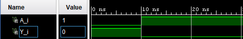

# 🔌 NOT_Gate Design

Implementación VHDL de una puerta lógica NOT. Incluye el código fuente y el testbench para la simulación y la comprobación del diseño.

## 📂 Ficheros Principales
* **NOT_Gate.vhdl:** Código fuente con la entidad y la arquitectura.
* **NOT_Gate_tb.vhdl:** Testbench para simular el diseño y comprobar su comportamiento.

## ⚙️ Simulación y Salidas Esperadas

### 📊 Tabla de Verdad: Puerta Lógica NOT

| Entrada A | Salida (NOT A) |
| :---: | :---: |
| 0 | **1** |
| 1 | **0** |

 
