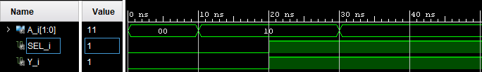

# 🔌 MUX_2_1 Design

Implementación VHDL de un Multiplexor 2:1. Incluye el código fuente y el testbench para la simulación y la comprobación del diseño.

## 📂 Ficheros Principales
* **MUX_2_1.vhdl:** Código fuente con la entidad y la arquitectura.
* **MUX_2_1_tb.vhdl:** Testbench para simular el diseño y comprobar su comportamiento.

## ⚙️ Simulación y Salidas Esperadas

### 📊 Tabla de Verdad: Multiplexor 2:1

| SEL | Entrada A(1) | Entrada A(0) | Y |
| :---: | :---: | :---: | :---: |
| 0 | 0 | 0 | **0** |
| 0 | 0 | 1 | **1** |
| 1 | 1 | 0 | **1** |
| 1 | 1 | 1 | **1** |

 
