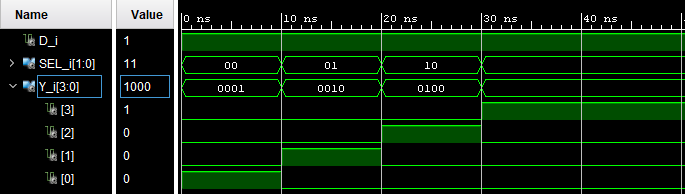

# 🔌 DEMUX_1_4 Design

Implementación VHDL de un Demultiplexor 1:4. Incluye el código fuente y el testbench para la simulación y la comprobación del diseño.

## 📂 Ficheros Principales
* **DEMUX_1_4.vhdl:** Código fuente con la entidad y la arquitectura.
* **DEMUX_1_4_tb.vhdl:** Testbench para simular el diseño y comprobar su comportamiento.

## ⚙️ Simulación y Salidas Esperadas

### 📊 Tabla de Verdad: Demultiplexor 1:4

| SEL[1] | SEL[0] | D | Y[3] | Y[2] | Y[1] | Y[0] |
| :---: | :---: | :---: | :---: | :---: | :---: | :---: |
| 0 | 0 | 1 | **0** | **0** | **0** | **1** |
| 0 | 1 | 1 | **0** | **0** | **1** | **0** |
| 1 | 0 | 1 | **0** | **1** | **0** | **0** |
| 1 | 1 | 1 | **1** | **0** | **0** | **0** |

 
