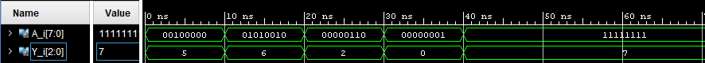

# 🔌 Priority_ENCODER_8_3 Design

Implementación VHDL de un Priority Encoder 8:3. Incluye el código fuente y el testbench para la simulación y la comprobación del diseño.

## 📂 Ficheros Principales
* **PriENCODER_8_3.vhdl:** Código fuente con la entidad y la arquitectura.
* **Pri_ENCODER_8_3_tb.vhdl:** Testbench para simular el diseño y comprobar su comportamiento.

## ⚙️ Simulación y Salidas Esperadas

### 📊 Casos de Prueba: Codificador 8:3 con prioridad.

| A[7] | A[6] | A[5] | A[4] | A[3] | A[2] | A[1] | A[0] | Y |
| :---: | :---: | :---: | :---: | :---: | :---: | :---: | :---: | :---: |
| 0 | 0 | 1 | 0 | 0 | 0 | 0 | 0 | 5 |
| 0 | 1 | 0 | 1 | 0 | 0 | 1 | 0 | 6 |
| 0 | 0 | 0 | 0 | 0 | 1 | 1 | 0 | 2 |
| 0 | 0 | 0 | 0 | 0 | 0 | 0 | 1 | 0 |
| 1 | 1 | 1 | 1 | 1 | 1 | 1 | 1 | 7 |

 
