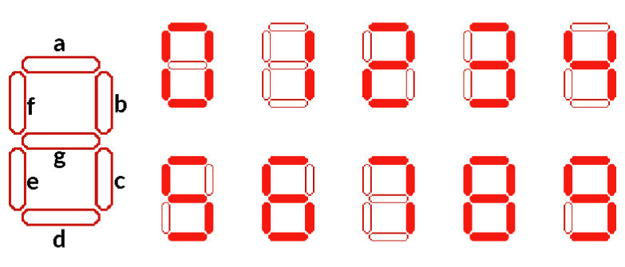
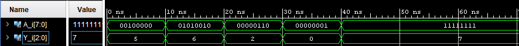

# 🔌 Seven Segment Display Driver (0 - 9) Design

Implementación VHDL de Seven Segment Display. Incluye el código fuente y el testbench para la simulación y la comprobación del diseño.

## 📂 Ficheros Principales
* **SevenSegment.vhdl:** Código fuente con la entidad y la arquitectura.
* **SevenSegment_tb.vhdl:** Testbench para simular el diseño y comprobar su comportamiento.

## ⚙️ Mapeo de Segmentos (Cátodo común)

## ⚙️ Simulación y Salidas Esperadas

El diseño muestra cada uno de los dígitos del 0 - 9 cuyo cambio se produce cada cada 2 ns.

## 📊 Casos de Prueba: Codificador 8:3 con prioridad.

| Decimal | A | Y | Segments (a-g) |
| :---: | :---: | :---: | :---: |
| 0 | 0000 | 1111110 | a-b-c-d-e-f | 
| 1 | 0001 | 0110000 | b-c |
| 2 | 0010 | 1101101 | a-b-d-e-g |
| 3 | 0011 | 1111001 | a-b-c-d-g |
| 4 | 0100 | 0110011 | b-c-f-g |
| 5 | 0101 | 1011011 | a-c-d-f-g |
| 6 | 0110 | 1011111 | a-c-d-e-f-g |
| 7 | 0111 | 1110000 | a-b-c |
| 8 | 1000 | 1111111 | a-b-c-d-e-f-g |
| 9 | 1001 | 1111011 | a-b-c-d-f-g |

 
