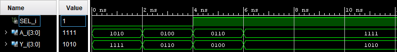

# 🔌 Binary To Gray And Gray To Binary Module Design

Implementación VHDL de BinToGray_GrayToBib. Se trata de un módulo configurable que convierte un dato Binario en Gray o viceversa. El tipo de conversión lo determina el puerto SEL (SEL = '0' --> Binary To Gray; SEL = '1' --> 
Gray To Binary). El tamaño del dato a convertir viene dado por el genérico N.
Incluye el código fuente y el testbench para la simulación y la comprobación del diseño.

## 📂 Ficheros Principales
* **BinToGray_GrayToBin.vhdl:** Código fuente con la entidad y la arquitectura.
* **BinToGray_GrayToBin_tb.vhdl:** Testbench para simular el diseño y comprobar su comportamiento.

## ⚙️ Simulación y Salidas Esperadas
La misma tabla muestra la conversión de Binario a Gray y de Gray a Binario.

### 📊 Casos de Prueba: Binary To Gray y Gray To Binary.
  
| A (Binary) | Y (Gray) |
| :---: | :---: |
| 0000 | 0000 |
| 0001 | 0001 |
| 0010 | 0011 |
| 0011 | 0010 |
| 0100 | 0110 |
| 0101 | 0111 |
| 0110 | 0101 |
| 0111 | 0100 |
| 1000 | 1100 |
| 1001 | 1101 |
| 1010 | 1111 |
| 1011 | 1110 |
| 1100 | 1010 |
| 1101 | 1011 |
| 1110 | 1001 |
| 1111 | 1000 |

### 📊 Formas de Onda.
En el test bench durante los 4 ns iniciales se realiza una conversión Binario a Gray de los datos 1010 y 0100. Los ns restantes de la simulación, una conversión Gray a Binario de los datos 0110 y 1111.
Por el puerto Y podemos ver el resultado de la conversión de los datos tanto en formato Binario como Gray.

