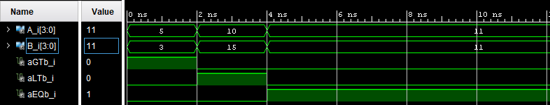

# 🔌 4 Bit Comparator Design

Implementación VHDL de un Comparador de 4 Bits. Se trata de un modulo que recibe dos número binarios y determina cual de ellos es mayor o si por el contrario son iguales. El diseño cuenta con 3 puertos de salida
que indican esto mismo. Se activan con un flanco de subida '1' y solamente uno de ellos puede estar en este estado.

Incluye el código fuente y el testbench para la simulación y la comprobación del diseño.

## 📂 Ficheros Principales
* **Comparator4Bit.vhdl:** Código fuente con la entidad y la arquitectura.
* **Comparator4Bit_tb.vhdl:** Testbench para simular el diseño y comprobar su comportamiento.

## ⚙️ Simulación y Salidas Esperadas
La misma tabla muestra la conversión de Binario a Gray y de Gray a Binario.

### 📊 Comportamiento: Comparador 4 Bits.
  
| Puerto | Dirección | Descripción |
| :---: | :---: | :---: |
| A | IN | Primer Dato Binario |
| B | IN | Segundo Dato Binario |
| aGTb | OUT | '1' si A > B |
| aLTb | OUT | '1' si A < B |
| aEQb | OUT | '1' si A = B |

### 📊 Formas de Onda.
En el Test Bench se realizan las siguiente comparaciones de datos:
* A = 5, B = 3 --> A > B
* A = 10, B = 15 --> A < B
* A = 11, B = 11 --> A = B

